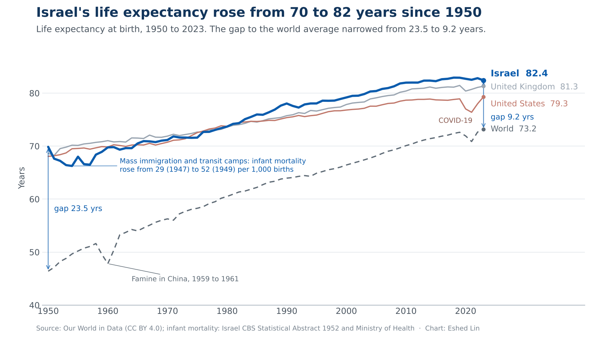

# Life expectancy in Israel since 1950

Israel's life expectancy at birth rose from 69.9 years in 1950 to 82.4 in 2023.
Over the same period, its lead over the world average narrowed from 23.5 years to 9.2.

## Question
How has life expectancy at birth in Israel changed since 1950,
compared with the United States, the United Kingdom and the world average?

## Data
Our World in Data, life expectancy at birth, one value per country per year.
Source, license and column names are documented in [data/README.md](data/README.md).

## Method
1. Keep four entities: Israel, United States, United Kingdom, World.
2. Keep the years from 1950 onwards.
3. Plot one line per entity and measure the gap between Israel and the world
   in the first and last year.

The script `src/make_chart.py` runs all three steps and prints the key numbers.

## Key finding
- 1950: Israel 69.9, world 46.4, a gap of 23.5 years.
- 2023: Israel 82.4, world 73.2, a gap of 9.2 years.

Israel kept rising, but the world rose much faster, so the gap narrowed.

## Note on the 1950s dip
UN estimates show Israel's life expectancy falling from 69.9 (1950) to 66.3 (1954).

- **Verified:** Jewish infant mortality rose from 29.2 (1947) to 51.7 (1949) per 1,000
  live births during the mass immigration, and reached 157.8 in the transit camps
  in 1950 (CBS Statistical Abstract 1952; Kanev Committee).
- **Not verified:** that this explains the timing or size of the dip. Infant mortality
  was already falling by 1953-54, and CBS five-year life tables for Jews show a rise
  between 1950-54 and 1955-59. Part of the dip may reflect UN estimation method.

## How to reproduce
1. Download the CSV described in [data/README.md](data/README.md) into `data/raw`
2. From the project root, run `python src/make_chart.py`
3. The chart is saved to `reports/figures` and the gap numbers are printed

## Status
v0.1: first analysis complete. 
Next: reproduce in SQL and check the 1950s dip against annual CBS infant mortality data.

## License

Code: MIT, see [LICENSE](LICENSE). Data: Our World in Data, CC BY 4.0, not stored in this repository (see [data/README.md](data/README.md)).
